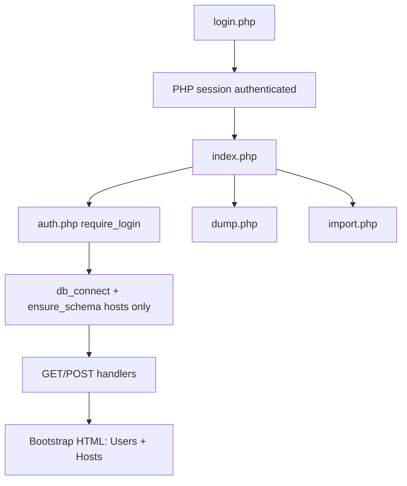

# user-mgr — Architecture Summary

PHP + MariaDB web app for managing Linux-style **user profiles** and **host groups** in MySQL. Docker Compose exposes the app on port 8080, MariaDB on 3306, phpMyAdmin on 8081.

## Request flow

Every page load (except login) goes through `src/auth.php`, which starts a session and redirects to `login.php` if `$_SESSION['authenticated']` is missing. Operator credentials come from environment / `src/config.php` (`ADMIN_USER` / `ADMIN_PASS`), not from MySQL.

`src/index.php` is a single monolithic script: PHP handles all mutations at the top, then loads full user/host lists and renders two sections on one page (`#users`, `#hosts`).

## Server-side behavior in `index.php`

| Trigger | Action |
|--------|--------|
| `?delete=` | `DELETE FROM users WHERE id = ?` → redirect |
| `?delete_host=` | `DELETE FROM hosts WHERE id = ?` → redirect `#hosts` |
| `?edit=` / `?edit_host=` | Load row into form state (`$update_mode` / `$host_update_mode`) |
| `POST save` | Insert or update user; required: name, uid, gid, email |
| `POST save_host` | Insert or update host; required: fqdn, groupname, host gid |

### ID allocation

- **Users:** `next_uid_gid()` — uid and gid are both derived from `COALESCE(MAX(uid), 4999) + 1` and `COALESCE(MAX(gid), 4999) + 1` from `users` (same query; new users often get matching uid/gid).
- **Hosts:** `next_host_gid()` — `COALESCE(MAX(gid), 5999) + 1` from `hosts` (separate gid namespace from user gids).

### Host helpers

- `fqdn_to_groupname()` — lowercase FQDN, dots → dashes (e.g. `tom1.tsand.org` → `tom1-tsand-org`).
- `normalize_members()` — always keeps `ansible`, `sudo`, `wheel` first, then appends any extra comma/space-separated groups (lowercased).

### User `access_host`

- Stored as a string: `none`, `all`, a host **FQDN**, or legacy values (`%`, empty → treated as `all` in the UI; old **groupname** values are mapped to FQDN when possible).
- The form dropdown is built from rows in `hosts`, plus a “current” option if the DB value is not in the list.

### Host membership sync (users → `hosts.members`)

When a user is saved or deleted, `index.php` updates machine-group member lists on `hosts` (same idea as csv-user-manager’s `sync_user_host_members`):

- **`access_host` = `all`** — username is added to every host’s `members` (after `ansible,sudo,wheel`).
- **Specific FQDN** — username is added only on the matching host row.
- **`none`** — username is not added; changing to `none` removes the user from host member lists.
- **Edit** — changing access or renaming the user removes the old username from affected hosts and adds the new one.
- **Delete** — username is removed from all hosts’ `members`.

### Errors

- PDO `23000` → friendly duplicate message (unique on `name`, `uid` for users; `fqdn`, `groupname`, `gid` for hosts).

### Client-side (inline script)

- Typing username auto-fills home as `/share/home/<name>` unless the user edited home manually.
- Typing FQDN auto-fills groupname unless groupname was edited manually.

## Database schema

Canonical DDL: [`sql`](sql) and [`hosts.sql`](hosts.sql). Sample data dump: [`users.sql`](users.sql).

### Table `users`

| Column | Type | Constraints / notes |
|--------|------|---------------------|
| `id` | INT | PK, AUTO_INCREMENT |
| `name` | VARCHAR(32) in dump; VARCHAR(32) in `sql` | UNIQUE (username) |
| `uid` | INT | UNIQUE |
| `gid` | INT | Not unique in schema |
| `email` | VARCHAR(32) in dump; VARCHAR(255) in `sql` | Required in UI |
| `shell` | VARCHAR(100) | Default `/bin/bash` |
| `home` | VARCHAR(255) | Required in DB |
| `public_key` | TEXT | Optional |
| `access_host` | VARCHAR(255) | Default `localhost` in DDL; UI defaults new forms to `all` |

### Table `hosts`

| Column | Type | Constraints |
|--------|------|-------------|
| `id` | INT | PK, AUTO_INCREMENT |
| `fqdn` | VARCHAR(255) | UNIQUE |
| `groupname` | VARCHAR(255) | UNIQUE |
| `gid` | INT | UNIQUE (machine group GID; UI copy says 6000+) |
| `members` | TEXT | Comma-separated; normalized on save |

### Schema bootstrap

`src/auth.php` `ensure_schema()` only runs `CREATE TABLE IF NOT EXISTS hosts`. The **`users` table is not auto-created** on connect. Apply `sql`, import `users.sql`, or use CLI loaders such as `load-data.php` / `import_csv.php`.

## Related entry points

| Path | Role |
|------|------|
| `src/login.php` / `src/logout.php` | Session auth |
| `src/dump.php` | SQL export (`SHOW CREATE TABLE` + row data) |
| `src/import.php` | Import dump |
| `load-data.php`, `import_csv.php` | CSV → `users` (headers like `public-key` map to `public_key`) |
| `create_users.php` | Additional user-creation utility (see repo) |
| `docker-compose.yml`, `Makefile` | `make build` / `make up` / `make down` |

## Config (Docker defaults)

From `docker-compose.yml` and `src/config.php`:

- DB: host `db`, database `users`, user `root` (overridable via `DB_*` env vars).
- Admin login: `ADMIN_USER` / `ADMIN_PASS` (defaults `admin` / `theresa1` in compose).

## Relation to csv-user-manager

[`/home/tsandholm/prog/csv-user-manager`](/home/tsandholm/prog/csv-user-manager) contains a separate **CSV + Ansible** user manager under `user-mgr/` (no MySQL). This repo (`/home/tsandholm/prog/user-mgr`) is the database-backed variant described in the root [`README.md`](README.md).
