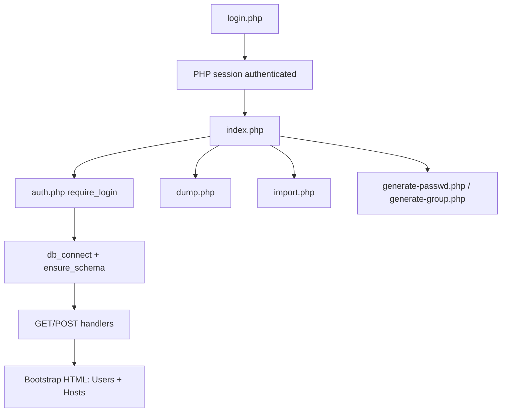

# user-mgr — Project Summary

A small **PHP 8.3 + MariaDB** web app for keeping Linux-style account data in SQL: user
profiles in `users`, host/machine groups in `hosts`. The database is the source of truth;
the app renders `/etc/passwd` and `/etc/group`-style exports, and Ansible playbooks push
those exports onto real hosts with `useradd`/`groupadd`/`gpasswd`.

Docker Compose runs three services: **web** on `8080`, **MariaDB 10.11** on `3306`,
**phpMyAdmin** on `8081`.

## Repository layout

| Path | Role |
|------|------|
| `src/` | The web app (the only directory mounted into the container) |
| `ansible/` | Playbooks that apply the generated exports to hosts |
| `exports/` | Runtime output of the generators, shared with the host via a volume |
| `Makefile`, `Dockerfile`, `docker-compose.yml` | Build / run tooling |
| `sql`, `hosts.sql`, `users.sql`, `user-mgr-dump_*.sql` | Canonical DDL and sample dumps |
| `users.csv`, `generate-*.php`, `load-data.php`, `import_csv.php`, `create_users.php` | CLI / legacy utilities |
| `sample-*.txt` (repo root) | Older hand-made snapshots of the export format |
| `summary.md` | This document |

## Request flow

Every page except `login.php`/`logout.php` loads `src/auth.php`, which starts a session,
builds `$config`, and redirects to `login.php` when `$_SESSION['authenticated']` is missing.
Operator credentials come from env vars (`ADMIN_USER`/`ADMIN_PASS`), **not** from MySQL.

`src/index.php` is one monolithic script: all mutations run at the top, then it loads full
user and host lists and renders both sections on a single page (`#users`, `#hosts`).

## App files (`src/`)

| File | Behavior |
|------|----------|
| `config.php` | Returns DB + admin config from `DB_*` / `ADMIN_*` env vars, with in-code defaults |
| `auth.php` | Session bootstrap, `db_connect()`, `ensure_schema()`, `attempt_login()` (constant-time `hash_equals`, session ID regeneration), `logout()` |
| `login.php` / `logout.php` | Sign-in form and session teardown |
| `index.php` | User + host CRUD, auto-filled next UID/GID, access-host rule, host membership sync, Bootstrap UI, inline auto-fill JS |
| `host_membership.php` | Membership logic: `DEFAULT_HOST_MEMBERS`, member normalization, access→host matching, add/remove/reconcile users in `hosts.members` |
| `dump.php` | Streams a `user-mgr-dump_<timestamp>.sql` download (`SHOW CREATE TABLE` + INSERTs for `users` and `hosts`) |
| `import.php` | Upload a `.sql` dump (≤10 MB); a hand-written splitter + allow-list executes only statements touching `users`/`hosts` |
| `passwd_export.php` | Formats `name:x:uid:gid:email:home:shell` lines |
| `group_export.php` | Formats `group:x:gid:members` host lines, then per-user primary-group lines |
| `sample_file_write.php` | Resolves the export directory (`/exports` in Docker, `../exports` otherwise) and writes the file |
| `generate-passwd.php`, `generate-group.php` | Dual-mode: CLI (uses `$argv[1]`) or authenticated web button; writes the export and redirects with a count |

### Server-side behavior in `index.php`

| Trigger | Action |
|--------|--------|
| `?delete=` | Look up name → `DELETE FROM users` → prune that name from every host's `members` |
| `?delete_host=` | `DELETE FROM hosts WHERE id = ?` → redirect to `#hosts` |
| `?edit=` / `?edit_host=` | Load the row into form state (`$update_mode` / `$host_update_mode`) |
| `POST save` | Insert or update a user; required: name, uid, gid, email |
| `POST save_host` | Insert or update a host; required: fqdn, groupname, gid; new hosts trigger a full reconcile |

**ID allocation**

- Users: `next_uid_gid()` uses `COALESCE(MAX(uid),4999)+1` and `COALESCE(MAX(gid),4999)+1`
  from `users`, so a new profile usually gets a matching uid/gid (5000+).
- Hosts: `next_host_gid()` uses `COALESCE(MAX(gid),5999)+1` from `hosts` (separate 6000+ namespace).

**Host helpers**

- `fqdn_to_groupname()` lowercases and turns dots into dashes (`tom1.tsand.org` → `tom1-tsand-org`).
- `normalize_members()` always keeps `ansible,sudo,wheel` first, then appends extra
  comma/space-separated groups, lowercased and de-duplicated.

**`access_host`**

Stored as `none`, `all`, or a host FQDN. Legacy `%` and empty values are normalized to `all`;
old groupname values are mapped back to an FQDN for the dropdown. The dropdown is built from
`hosts`, plus a “(current)” entry when the stored value matches no host.

**Membership sync (`hosts.members`)**

- `all` → the username is added to every host after `ansible,sudo,wheel`.
- Specific FQDN/groupname → added only to matching host rows.
- `none` → removed from every host; changing to `none` prunes the user.
- Edit → renaming or changing access removes the old name and adds the new one.
- Delete → the name is removed everywhere.
- Reconcile → `reconcile_all_user_host_members()` replays every user's rule (used when a host is added).

**Errors** — PDO `23000` becomes a friendly duplicate message (`name`/`uid` for users;
`fqdn`/`groupname`/`gid` for hosts).

**Client-side (inline JS)** — typing a username fills home as `/share/home/<name>`; typing an
FQDN fills groupname as dots→dashes. Both stop auto-filling once edited manually.

## Database

Canonical DDL: `sql` (both tables) and `hosts.sql` (hosts only). Sample data: `users.sql`
(phpMyAdmin dump, 2 users) and `user-mgr-dump_2026-10-24_214517.sql` (2 users, 4 hosts).

### `users`

| Column | Type | Notes |
|--------|------|-------|
| `id` | INT | PK, AUTO_INCREMENT |
| `name` | VARCHAR(32) | UNIQUE |
| `uid` | INT | UNIQUE |
| `gid` | INT | Not unique |
| `email` | VARCHAR(255) in `sql`, VARCHAR(32) in dumps | Required in UI; used as GECOS |
| `shell` | VARCHAR(100) | Default `/bin/bash` |
| `home` | VARCHAR(255) | Required |
| `public_key` | TEXT | Optional |
| `access_host` | VARCHAR(255) | Default `localhost`; UI defaults new forms to `all` |

### `hosts`

| Column | Type | Notes |
|--------|------|-------|
| `id` | INT | PK, AUTO_INCREMENT |
| `fqdn` | VARCHAR(255) | UNIQUE |
| `groupname` | VARCHAR(255) | UNIQUE |
| `gid` | INT | UNIQUE; UI starts at 6000 |
| `members` | TEXT | Comma-separated, normalized on write |

**Schema bootstrap:** `ensure_schema()` creates *both* `users` and `hosts` with
`CREATE TABLE IF NOT EXISTS`, so a fresh Docker database is usable immediately.

## Export → Ansible pipeline

1. `generate-passwd.php` / `generate-group.php` (web buttons or CLI in the container) write
   `exports/sample-passwd.txt` and `exports/sample-group.txt`.
   - passwd: users ordered by uid, `name:x:uid:gid:email:home:shell`.
   - group: **host groups first** (ordered by gid, members after `ansible,sudo,wheel`), then one
     primary-group line per user, `name:x:gid:`.
   - Colons/newlines are stripped from group fields and replaced by spaces in passwd GECOS so
     the files stay parseable. Writes fail loudly if `/exports` is missing or not writable.
2. `ansible/playbooks/update-group-block.yml` (`hosts: virt`, `become`, `serial: 1`) reads the
   export on the controller, asserts it is non-empty, then imports `tasks/apply-group-export.yml`:
   removes a legacy `blockinfile` block from `/etc/group`, ensures each group exists with
   `ansible.builtin.group`, and uses `getent` + `gpasswd -M` to set supplementary members
   (only when they differ), then `grpconv`.
3. `ansible/playbooks/update-passwd-block.yml` does the same for `exports/sample-passwd.txt`,
   removing the legacy `/etc/passwd` block and applying each line through
   `ansible.builtin.user` (`uid`, `group`, `comment`, `home`, `shell`, `create_home: true`),
   then `pwconv`. Run the group playbook first so primary GIDs exist.

`ansible/ansible.cfg` sets the local inventory, `become: sudo`, pipelining, 10 forks, and
`StrictHostKeyChecking=accept-new`. `ansible/inventory.ini` ships with an empty `[virt]`
group and a commented `sv-quantum-lx25.infinera.com` example — it must be filled in per
environment. Both playbooks accept `-e group_export_file=... / passwd_export_file=...`.

## CLI / legacy utilities

| File | Notes |
|------|-------|
| `create_users.php` | Creates real system accounts from the DB (`posix_*` checks, `sudo useradd`, home, SSH key install, ownership fix) and prints passwd/group entries. Hardcodes `127.0.0.1` / `sysadm`. |
| `load-data.php` | CSV → `users` upsert (`ON DUPLICATE KEY UPDATE`) inside a transaction; hardcodes `10.0.0.44`. |
| `import_csv.php` | Same upsert with per-row column-count validation and line-number error reporting; also hardcodes `10.0.0.44`. |
| `generate-passwd.php`, `generate-group.php` (root) | Thin CLI wrappers around `src/*_export.php`, using `src/config.php` and `DB_PORT`. |
| `src/generate-*.php` | Web-facing versions of the same generators (also work from CLI). |
| `users.csv` | 4 sample users (`stu01`–`stu04`); headers use `public-key`/`access-host`, mapped to underscores. |

## Build & run

- `Dockerfile`: `php:8.3-apache` plus `mysqli pdo pdo_mysql`.
- `docker-compose.yml`: mounts `./src` into the web root and `./exports` at `/exports`; sets
  `DB_HOST=db`, `DB_NAME=users`, `DB_USER=root`, `DB_PASS`, `ADMIN_USER=admin`, `ADMIN_PASS`;
  MariaDB 10.11 with a named `db_data` volume and a `sysadm` side user; phpMyAdmin via `PMA_HOST=db`.
- `Makefile`: `build` (up --build), `up`, `down`, `status`, `show-users` and `show-groups`
  (query MySQL on `127.0.0.1` and print colon-separated rows).

## Observations / rough edges

- **Duplicate entry points:** root `generate-*.php` and `src/generate-*.php` do the same job;
  only `src/` is mounted into the container.
- **Credentials in the repo:** DB password, root password, and admin password all default to
  the same literal value in `config.php`, `docker-compose.yml`, and the CLI scripts; there is
  no `.env` file or secret management.
- **Hardcoded hosts** in `load-data.php` / `import_csv.php` (`10.0.0.44`) and
  `create_users.php` (`127.0.0.1`, `sysadm`) do not read `config.php`.
- **Type drift:** `email` is VARCHAR(32) in `users.sql` and the generated dump but VARCHAR(255)
  in `sql` and `ensure_schema()`; `sample-*.txt` at the repo root are stale copies of the
  format produced by the generators.
- **No tests, no CI, no linter** in the repository; the README is a three-line stub.
- Working tree currently has uncommitted edits to `Makefile`, `docker-compose.yml`, and the
  three `exports/` files.
